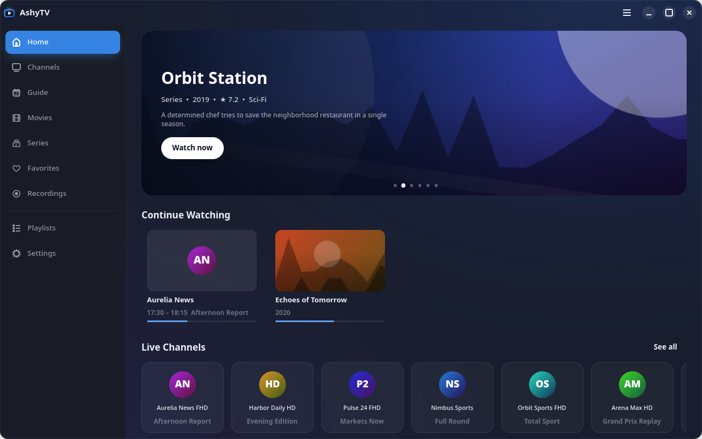
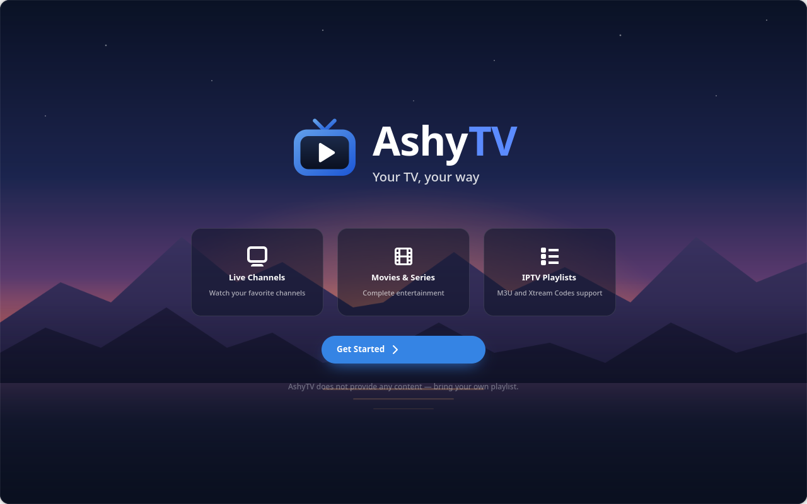
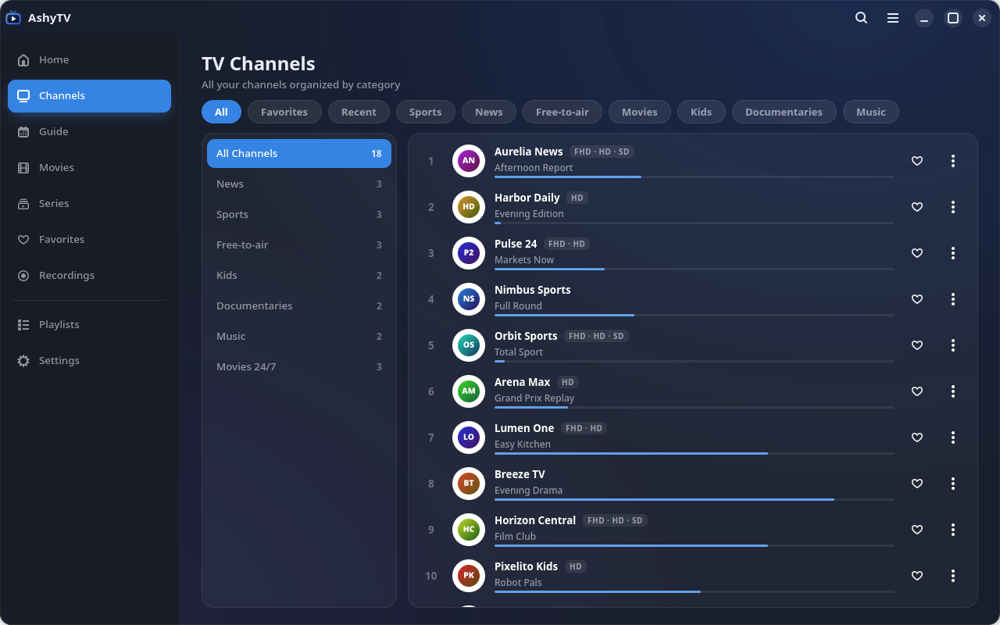
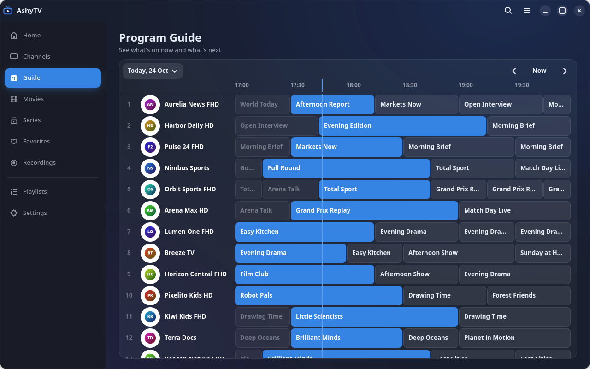
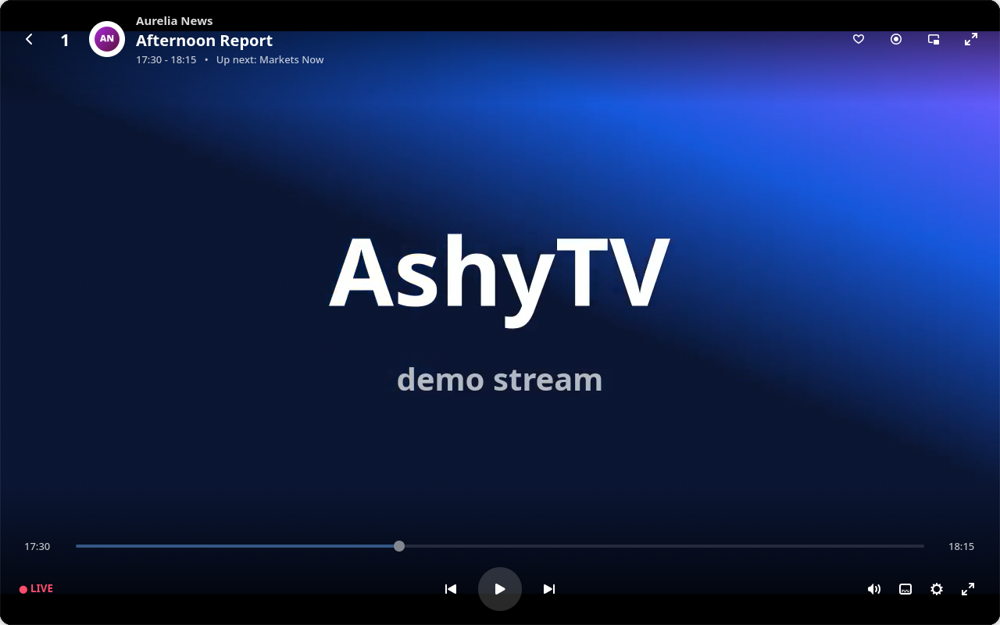
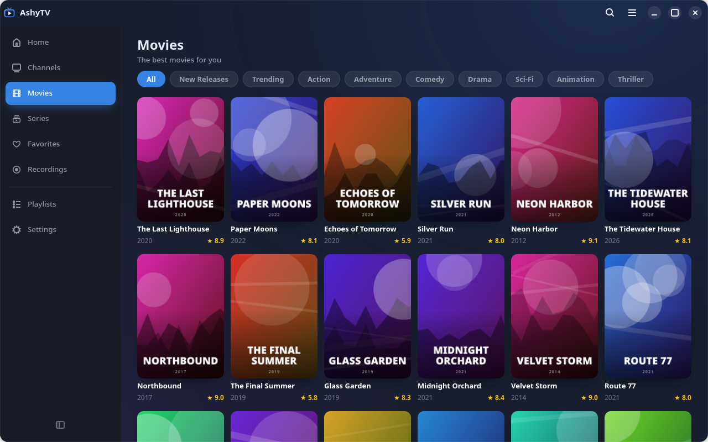
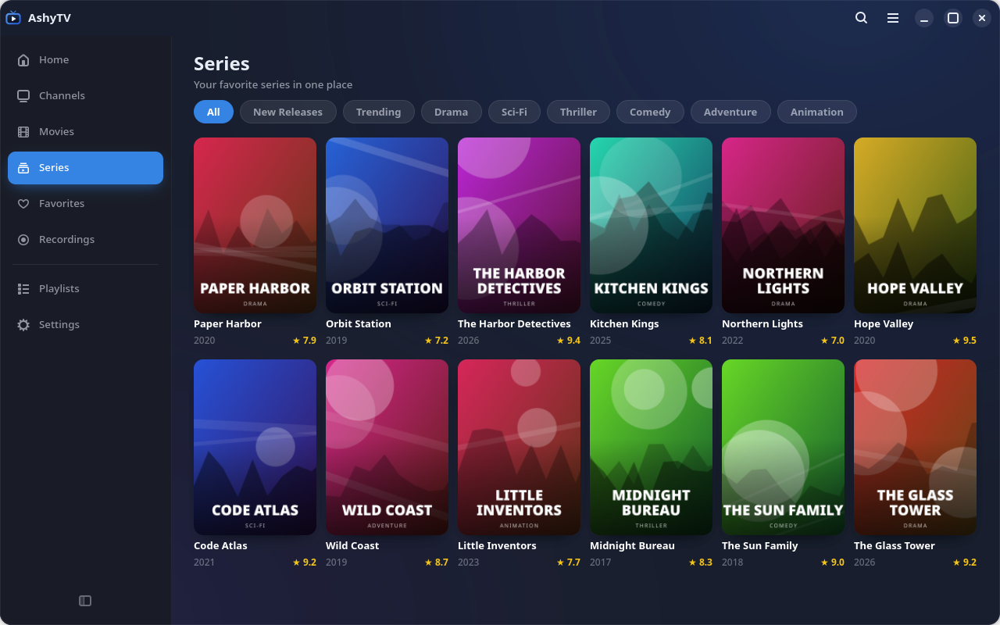
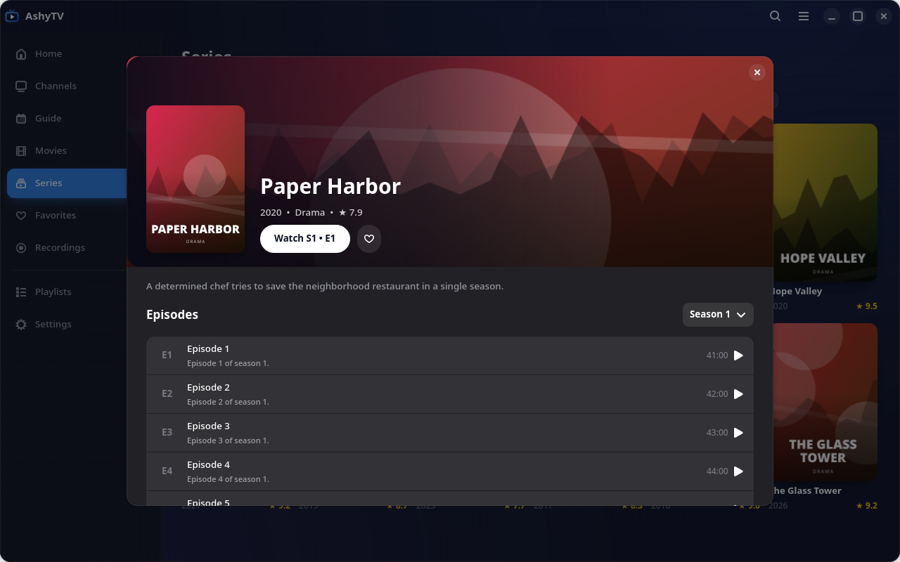
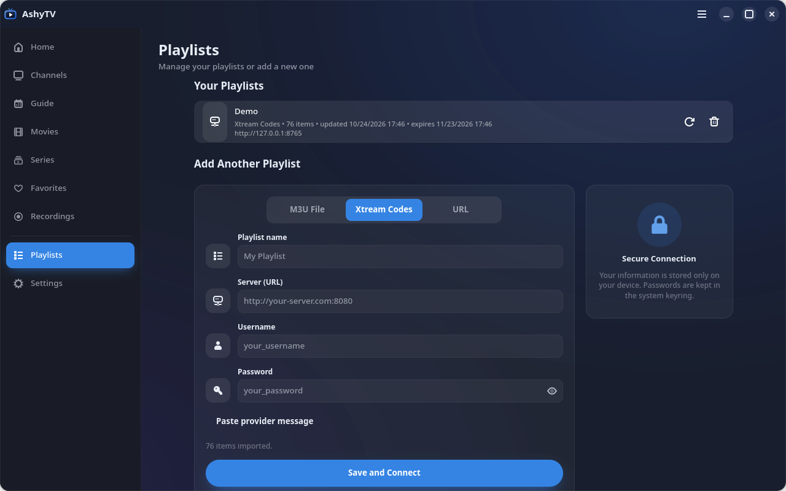
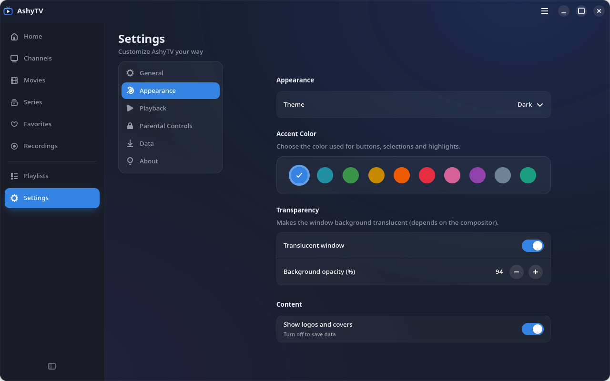

<div align="center">


# AshyTV

**A modern IPTV player for the Linux desktop — built with GTK4 and libadwaita.**

Bring your own M3U playlist or Xtream Codes account and enjoy live TV,
a program guide, movies and series in a fast, good-looking app.

[](LICENSE)


</div>



> [!IMPORTANT]
> **AshyTV does not provide, host or include any content.** It is only a
> player and organizer for playlists you are legally entitled to use. All
> screenshots in this repository were made with a bundled demo server that
> generates fictional channels, artwork and video ([tools/demo](tools/demo)).

## Table of contents

- [Features](#features)
- [Screenshots](#screenshots)
- [Installation](#installation)
- [Getting started](#getting-started)
- [Keyboard shortcuts](#keyboard-shortcuts)
- [Settings and data](#settings-and-data)
- [Translations](#translations)
- [Development](#development)
- [Project layout](#project-layout)
- [Privacy](#privacy)
- [Credits](#credits)
- [License](#license)

## Features

**Playlists**
- M3U / M3U8 from a local file or URL, and **Xtream Codes** accounts.
- Paste the welcome message from your provider — server, username and
  password are detected automatically.
- Xtream catalogs are loaded through `player_api.php` (live, movies, series,
  ratings, years, artwork, account expiration); episodes are fetched on demand.
- Robust M3U parsing: titles with commas, `#EXTGRP`, `#EXTVLCOPT` user agent
  and referrer, `url-tvg` guides, live/movie/series detection from the stream
  URL, and loose episodes grouped into series.
- Imports run in the background — even playlists with hundreds of thousands
  of entries keep the interface responsive.
- Refresh or remove playlists, with optional automatic refresh.

**Watching**
- **Live TV** with category chips, groups, favorites, recently watched and the
  current program with its progress.
- **One entry per channel**: "News FHD", "News HD" and "News SD" are grouped
  into a single channel, with its qualities shown as a badge.
- **Program guide** (XMLTV) in a time grid with a "now" line, day picker and
  hour navigation; per-channel schedule.
- **Movies & series** catalog with posters, ratings, years, new releases,
  trending, search and categories; series with seasons, episodes and an
  automatic next episode.
- **Continue watching**: movies and episodes resume where you stopped.

**Player** (libmpv)
- **Automatic quality**: steps down to a lighter variant when playback keeps
  stalling, back up after a stable period, and falls back automatically when a
  variant is offline. Any quality can also be picked by hand.
- Hardware decoding and a configurable network buffer.
- Channel zapping, ±10 s seeking, volume, subtitles, audio tracks, aspect
  ratio and playback speed.
- Program info and progress bar on live channels.
- **Picture-in-picture** mini player and **recording** of live streams.
- Auto-hiding controls and cursor; clear loading and error states.

**Look & feel**
- Dark and light themes, ten accent colors and translucent panels.
- Adaptive layout that collapses the sidebar on narrow windows.
- Parental controls (hide adult categories, optional PIN).
- Translated into 29 languages.

## Screenshots

| | |
|:--:|:--:|
| <br>Welcome | <br>Live channels |
| <br>Program guide | <br>Player |
| <br>Movies | <br>Series |
| <br>Series details | <br>Playlists |
| <br>Settings | |

## Installation

### BigLinux / BigCommunity / Arch Linux

A `PKGBUILD` is provided in [`pkgbuild/`](pkgbuild/PKGBUILD):

```bash
git clone https://github.com/big-comm/ashytv.git
cd ashytv/pkgbuild
makepkg -si
```

### From source

Install the runtime dependencies with your distribution's package manager:

| Dependency | Arch / BigLinux | Debian / Ubuntu | Fedora |
|---|---|---|---|
| GTK 4 (≥ 4.16) | `gtk4` | `libgtk-4-1` | `gtk4` |
| libadwaita (≥ 1.6) | `libadwaita` | `libadwaita-1-0` | `libadwaita` |
| PyGObject | `python-gobject` | `python3-gi` | `python3-gobject` |
| libmpv + python-mpv | `mpv python-mpv` | `libmpv2` + `pip install python-mpv` | `mpv-libs python3-mpv` |
| librsvg (SVG artwork) | `librsvg` | `librsvg2-common` | `librsvg2` |
| libsecret *(optional)* | `libsecret` | `gir1.2-secret-1` | `libsecret` |

Then run it straight from the source tree:

```bash
git clone https://github.com/big-comm/ashytv.git
cd ashytv
./run.sh
```

## Getting started

1. Open AshyTV and click **Get Started**.
2. In **Playlists**, choose one of:
   - **M3U File** — pick a `.m3u` / `.m3u8` file;
   - **Xtream Codes** — enter server, username and password, or use
     **Paste provider message** to fill them in from the text you received;
   - **URL** — the address of an M3U playlist.
3. Click **Save and Connect**. Channels, movies, series and the program guide
   are loaded in the background.

Want to try it without a playlist? Start the demo server and add it as an
Xtream account (server `http://127.0.0.1:8765`, username `demo`,
password `demo`):

```bash
python3 tools/demo/demo_server.py
```

## Keyboard shortcuts

| Key | Action |
|---|---|
| <kbd>Space</kbd> | Play / pause |
| <kbd>↑</kbd> / <kbd>↓</kbd> | Previous / next channel (or episode) |
| <kbd>←</kbd> / <kbd>→</kbd> | Seek −10 s / +10 s |
| <kbd>F</kbd> or double click | Toggle fullscreen |
| <kbd>M</kbd> | Mute |
| <kbd>+</kbd> / <kbd>−</kbd> / mouse wheel | Volume |
| <kbd>Esc</kbd> | Leave fullscreen, then close the player |
| <kbd>Ctrl</kbd>+<kbd>F</kbd> | Search |
| <kbd>Ctrl</kbd>+<kbd>?</kbd> | Keyboard shortcuts |
| <kbd>Ctrl</kbd>+<kbd>Q</kbd> | Quit |

## Settings and data

| What | Where |
|---|---|
| Playlists, favorites and history (SQLite) | `~/.local/share/ashytv/ashytv.db` |
| Preferences | `~/.config/ashytv/settings.json` |
| Logos, posters and guide cache | `~/.cache/ashytv/` |
| Recordings | `~/Videos/AshyTV/` |
| Xtream passwords | System keyring (libsecret), when available |

Cached artwork and the guide can be cleared in **Settings → Data**.

## Translations

AshyTV uses gettext. Source strings are in English; catalogs live in
[`locale/`](locale) and compiled files in `usr/share/locale/`.

Available languages: Bulgarian, Chinese, Croatian, Czech, Danish, Dutch,
English, Estonian, Finnish, French, German, Greek, Hebrew, Hungarian,
Icelandic, Italian, Japanese, Korean, Norwegian, Polish, Portuguese,
Portuguese (Brazil), Romanian, Russian, Slovak, Spanish, Swedish, Turkish
and Ukrainian.

After changing strings in the code:

```bash
tools/update_translations.sh          # regenerate ashytv.pot and merge the .po files
tools/update_translations.sh compile  # build the .mo files
```

To improve a translation, edit `locale/<language>.po` and open a pull request.

## Development

```bash
./run.sh                                # run from the source tree
python3 -m pytest                       # test suite (no network needed)
ruff check src tests tools              # lint
python3 tools/demo/demo_server.py       # fictional Xtream server for testing
python3 tools/demo/screenshots.py       # regenerate docs/screenshots
```

The demo server and the screenshot script only use generated, fictional data,
so screenshots can be refreshed at any time without third-party content.

## Project layout

```
src/ashytv/
├── application.py      # Adw.Application: theme, accent color, actions
├── window.py           # main window: navigation, import and playback flow
├── i18n.py             # gettext setup
├── models/             # Channel, Episode, PlayItem
├── services/           # M3U parser, Xtream client, EPG, storage (SQLite),
│                       # importer, artwork loader, settings, keyring
├── player/             # libmpv rendered in a Gtk.GLArea
├── ui/                 # player, dialogs, sidebar, guide timeline
│   └── pages/          # Home, Channels, Guide, Movies/Series, Favorites,
│                       # Recordings, Playlists, Settings
└── data/               # stylesheet, icons, images
tests/                  # pytest suite
tools/demo/             # fictional demo server + screenshot generator
locale/                 # translation catalogs (.pot / .po)
usr/                    # launcher, desktop entry, icons, metainfo, .mo files
pkgbuild/               # Arch Linux package
```

## Privacy

- Everything stays on your computer: playlists, favorites and history are
  stored locally, and Xtream passwords go to the system keyring when available.
- AshyTV only talks to the servers in the playlists you add (and to the image
  hosts they reference). There is no telemetry.

## Credits

- Developed by the [Community Big](https://communitybig.org) team.
- Playback powered by [mpv](https://mpv.io) through
  [python-mpv](https://github.com/jaseg/python-mpv).
- Some symbolic icons are bundled from GNOME's
  [Adwaita icon theme](https://gitlab.gnome.org/GNOME/adwaita-icon-theme)
  (CC-BY-SA 3.0) — see [`src/ashytv/data/icons/NOTICE.md`](src/ashytv/data/icons/NOTICE.md).
  The AshyTV logo, its own symbolic icons and the welcome artwork are original.

## License

AshyTV is released under the [MIT License](LICENSE). The bundled Adwaita
icons keep their original license.
