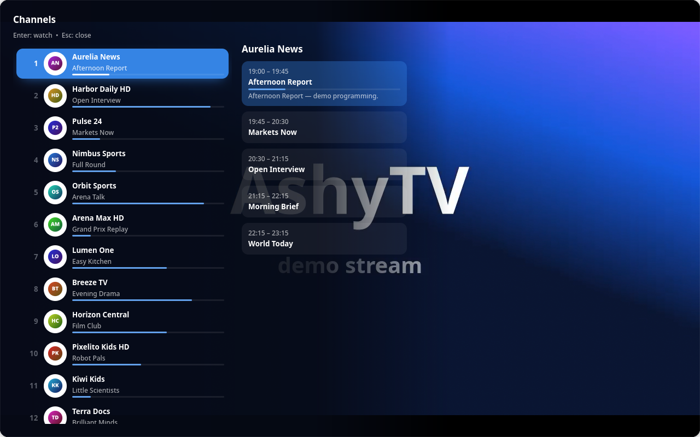

<div align="center">


# AshyTV

**A modern IPTV player for the Linux desktop — built with GTK4 and libadwaita.**

Watch free TV channels and open movies out of the box, or bring your own
M3U playlist or Xtream Codes account, with a program guide, movies and
series in a fast, good-looking app.

[](LICENSE)


</div>


> [!IMPORTANT]
> **AshyTV is only a player, like VLC or mpv. It does not host, provide,
> sell or own any channel, movie or series, and it has no servers.** It plays
> what is in the playlist you add, and the video goes straight from that
> source to your computer — nothing passes through or is stored by AshyTV or
> its developers. AshyTV does not sell, recommend or endorse any IPTV
> provider. Use it only with content you are legally entitled to watch.
>
> The optional **Free TV** list only *links* to channels broadcasters make
> freely available and to films with an open licence or in the public domain
> (see [Free TV](#free-tv) and the [Legal notice](#legal-notice)). All
> screenshots in this repository were made with a bundled demo server that
> generates fictional channels, artwork and video ([tools/demo](tools/demo)).

## Table of contents

- [Features](#features)
- [Screenshots](#screenshots)
- [Installation](#installation)
- [Getting started](#getting-started)
- [Keyboard, remote and game controller](#keyboard-remote-and-game-controller)
- [Settings and data](#settings-and-data)
- [Translations](#translations)
- [Development](#development)
- [Project layout](#project-layout)
- [Free TV](#free-tv)
- [Legal notice](#legal-notice)
- [Privacy](#privacy)
- [Credits](#credits)
- [License](#license)

## Features

**Playlists**
- **Free TV** (the first option): free-to-air channels from 80+ countries
  plus public domain classics, Blender's open movies and cartoons — see
  [Free TV](#free-tv).
- M3U / M3U8 from a local file or URL, and accounts that use the
  **Xtream Codes** API (from your own, legal provider).
- Paste the welcome message from your provider — server, username and
  password are detected automatically.
- Xtream catalogs are loaded through `player_api.php` (live, movies, series,
  ratings, years, artwork, account expiration); episodes are fetched on demand.
- Robust M3U parsing: titles with commas, `#EXTGRP`, `#EXTVLCOPT` user agent
  and referrer, `url-tvg` guides, live/movie/series detection from the stream
  URL, and loose episodes grouped into series.
- Imports run in the background — even playlists with hundreds of thousands
  of entries keep the interface responsive.
- Refresh, disable (keep it without showing its channels) or remove
  playlists, with optional automatic refresh.

**Watching**
- **Live TV** with category chips, groups, favorites, recently watched and the
  current program with its progress.
- **One entry per channel**: "News FHD", "News HD" and "News SD" are grouped
  into a single channel, with its qualities shown as a badge.
- **Program guide** (XMLTV) right in the Channels page (List | Guide switch):
  a time grid with a "now" line, day picker and hour navigation, showing the
  selected group; per-channel schedule.
- **Reminders**: "Remind me" on a future programme sends a notification with a
  Watch button a minute before it starts.
- Hide or reorder channel groups (right click or the Menu key).
- **Movies & series** catalog with posters, ratings, years, new releases,
  trending, search and categories; series with seasons, episodes and an
  automatic next episode.
- **Movie details** like a media center: synopsis, original title,
  duration and "ends at", director, cast, genres, country, release date,
  video/audio info, trailer and TMDB links (Xtream `get_vod_info`).
- **Continue watching**: movies and episodes resume where you stopped.

**Player** (libmpv)
- **Automatic quality**: steps down to a lighter variant when playback keeps
  stalling, back up after a stable period, and falls back automatically when a
  variant is offline. Any quality can also be picked by hand.
- **Channel list over the video** (TiviMate style): press Enter while watching
  to browse channels with their current programme and the highlighted
  channel's schedule — the video keeps playing.
- **Timeshift**: pause and rewind live TV inside the buffer, see how far behind
  live you are and jump back with **Go live**.
- Type a channel number like on a TV remote; jump back to the last channel.
- Hardware decoding and a configurable network buffer.
- Channel zapping, ±10 s seeking, volume, aspect ratio and playback speed.
- **Audio and subtitle tracks** with language names (CC and ⚙ buttons);
  your language is picked automatically when the file has it, provider
  subtitles are added, and you can load a subtitle file (`.srt`, `.ass`,
  `.vtt`…).
- Program info and progress bar on live channels.
- **Picture-in-picture** mini player and **recording** of live streams.
- Auto-hiding controls and cursor; clear loading and error states.

**Look & feel**
- Dark and light themes, ten accent colors and translucent panels.
- Collapsible, icons-only sidebar; adaptive layout for narrow windows.
- **Made for the couch**: everything works with the keyboard, a TV remote or a
  game controller; just start typing to search.
- Parental controls (hide adult categories, optional PIN).
- Translated into 29 languages.

## Screenshots

| | |
|:--:|:--:|
| <br>Welcome | <br>Live channels |
| <br>Program guide | <br>Player |
| <br>Channel list over the video | <br>Settings |
| <br>Movies | <br>Series |
| <br>Series details | <br>Playlists |

## Installation

### BigLinux / BigCommunity / Arch Linux

A `PKGBUILD` is provided in [`pkgbuild/`](pkgbuild/PKGBUILD):

```bash
git clone https://github.com/big-comm/ashytv.git
cd ashytv/pkgbuild
makepkg -si
```

### From source

Install the runtime dependencies with your distribution's package manager:

| Dependency | Arch / BigLinux | Debian / Ubuntu | Fedora |
|---|---|---|---|
| GTK 4 (≥ 4.16) | `gtk4` | `libgtk-4-1` | `gtk4` |
| libadwaita (≥ 1.6) | `libadwaita` | `libadwaita-1-0` | `libadwaita` |
| PyGObject | `python-gobject` | `python3-gi` | `python3-gobject` |
| libmpv + python-mpv | `mpv python-mpv` | `libmpv2` + `pip install python-mpv` | `mpv-libs python3-mpv` |
| librsvg (SVG artwork) | `librsvg` | `librsvg2-common` | `librsvg2` |
| libsecret *(optional)* | `libsecret` | `gir1.2-secret-1` | `libsecret` |
| libmanette *(optional, game controllers)* | `libmanette` | `gir1.2-manette-0.2` | `libmanette` |

Then run it straight from the source tree:

```bash
git clone https://github.com/big-comm/ashytv.git
cd ashytv
./run.sh
```

## Getting started

1. Open AshyTV and click **Get Started**.
2. In **Playlists**, choose one of:
   - **Free TV** — your country is preselected; choose another one or
     "All countries", and keep or turn off the free movies and cartoons;
   - **M3U File** — pick a `.m3u` / `.m3u8` file;
   - **Xtream Codes** — enter server, username and password, or use
     **Paste provider message** to fill them in from the text you received;
   - **URL** — the address of an M3U playlist.
3. Click **Save and Connect**. Channels, movies, series and the program guide
   are loaded in the background.

Want to try it without a playlist? Start the demo server and add it as an
Xtream account (server `http://127.0.0.1:8765`, username `demo`,
password `demo`):

```bash
python3 tools/demo/demo_server.py
```

## Keyboard, remote and game controller

Everything can be done without a mouse. Remotes that act as a keyboard
(USB / HDMI-CEC) work out of the box, and game controllers are supported
through libmanette.

**Anywhere**

| Key | Action |
|---|---|
| *start typing* or <kbd>Ctrl</kbd>+<kbd>F</kbd> | Search the current page |
| <kbd>←</kbd> <kbd>→</kbd> <kbd>↑</kbd> <kbd>↓</kbd> | Move to the nearest item in that direction — sidebar, filters, groups, lists, the buttons on a row (favorite, menu), dialogs |
| <kbd>Enter</kbd> | Open the selected item |
| <kbd>Backspace</kbd> / <kbd>Esc</kbd> | Back to the menu |
| <kbd>Menu</kbd> on a group | Move up / down or hide the group |
| <kbd>Ctrl</kbd>+<kbd>?</kbd> | Keyboard shortcuts (also in **Settings → Shortcuts**) |
| <kbd>Ctrl</kbd>+<kbd>Q</kbd> | Quit |

**While watching**

| Key | Action |
|---|---|
| <kbd>Enter</kbd> | Channel list over the video |
| <kbd>I</kbd> | Show programme info and controls |
| <kbd>Tab</kbd> | Go to the player buttons: arrows move, <kbd>Enter</kbd> presses, <kbd>Esc</kbd> leaves |
| <kbd>↑</kbd> / <kbd>↓</kbd> | Previous / next channel (or episode) |
| <kbd>0</kbd>–<kbd>9</kbd> | Type a channel number |
| <kbd>Backspace</kbd> | Last watched channel |
| <kbd>Space</kbd> | Play / pause (also pauses live TV) |
| <kbd>←</kbd> / <kbd>→</kbd> | Rewind / forward 10 s (inside the live buffer too) |
| <kbd>F</kbd> or double click | Toggle fullscreen |
| <kbd>M</kbd> | Mute |
| <kbd>+</kbd> / <kbd>−</kbd> / mouse wheel | Volume |
| <kbd>Esc</kbd> | Close the channel list, leave fullscreen, then close the player |

**Game controller**

| Button | Action |
|---|---|
| D-pad / left stick | Move (hold to repeat) |
| A | Open / confirm |
| B | Back |
| X | Play / pause |
| Y | Channel list |
| L1 / R1 | Previous / next channel |
| Select | Last watched channel |

## Settings and data

| What | Where |
|---|---|
| Playlists, favorites and history (SQLite) | `~/.local/share/ashytv/ashytv.db` |
| Preferences | `~/.config/ashytv/settings.json` |
| Logos, posters and guide cache | `~/.cache/ashytv/` |
| Recordings | `~/Videos/AshyTV/` |
| Xtream passwords | System keyring (libsecret), when available |

Cached artwork and the guide can be cleared in **Settings → Data**.

## Translations

AshyTV uses gettext. Source strings are in English; catalogs live in
[`locale/`](locale) and compiled files in `usr/share/locale/`.

Available languages: Bulgarian, Chinese, Croatian, Czech, Danish, Dutch,
English, Estonian, Finnish, French, German, Greek, Hebrew, Hungarian,
Icelandic, Italian, Japanese, Korean, Norwegian, Polish, Portuguese,
Portuguese (Brazil), Romanian, Russian, Slovak, Spanish, Swedish, Turkish
and Ukrainian.

After changing strings in the code:

```bash
tools/update_translations.sh          # regenerate ashytv.pot and merge the .po files
tools/update_translations.sh compile  # build the .mo files
```

To improve a translation, edit `locale/<language>.po` and open a pull request.

## Development

```bash
./run.sh                                # run from the source tree
python3 -m pytest                       # test suite (no network needed)
ruff check src tests tools              # lint
python3 tools/demo/demo_server.py       # fictional Xtream server for testing
python3 tools/demo/screenshots.py       # regenerate docs/screenshots
```

The demo server and the screenshot script only use generated, fictional data,
so screenshots can be refreshed at any time without third-party content.

## Project layout

```
src/ashytv/
├── application.py      # Adw.Application: theme, accent color, actions
├── window.py           # main window: navigation, import and playback flow
├── i18n.py             # gettext setup
├── models/             # Channel, Episode, PlayItem
├── services/           # M3U parser, Xtream client, EPG, storage (SQLite),
│                       # importer, artwork loader, settings, keyring
├── player/             # libmpv rendered in a Gtk.GLArea
├── ui/                 # player, dialogs, sidebar, guide timeline
│   └── pages/          # Home, Channels, Guide, Movies/Series, Favorites,
│                       # Recordings, Playlists, Settings
└── data/               # stylesheet, icons, images
tests/                  # pytest suite
tools/demo/             # fictional demo server + screenshot generator
locale/                 # translation catalogs (.pot / .po)
usr/                    # launcher, desktop entry, icons, metainfo, .mo files
pkgbuild/               # Arch Linux package
```

## Free TV

**Free TV** combines two lists. AshyTV only stores their links: the video
always comes from the original source.

1. **Free-to-air channels** from [Free-TV/IPTV](https://github.com/Free-TV/IPTV),
   the community list Linux Mint's Hypnotix uses by default. AshyTV fetches
   it by URL and **filters it on your computer**, keeping only broadcasters'
   own streams. It drops:
   - channels of commercial streaming platforms (Pluto TV, Samsung TV Plus,
     Plex, Roku, Tubi, Xumo, Rakuten), the FAST distributors that feed them
     (Amagi, Wurl, OTTera) and the services that re-serve them;
   - YouTube, Dailymotion and Twitch links, whose terms only allow their own
     players;
   - streams on bare IP addresses, relays/forwarders and URLs carrying a
     copied access token;
   - the on-demand ("VOD") sections.

   The filter rules are in [`free_tv.py`](src/ashytv/services/free_tv.py).
2. **A curated catalog** maintained in this repository
   ([`free_catalog.m3u`](src/ashytv/data/free_catalog.m3u), CC0):
   - live: [TV Câmara](https://www.camara.leg.br/tv/termos-de-uso/) (CC BY 4.0)
     and NASA TV (NASA media is not copyrighted in the US);
   - [Blender Studio](https://studio.blender.org) open movies — Big Buck
     Bunny, Elephants Dream, Sintel, Tears of Steel, Cosmos Laundromat —
     (CC) Blender Foundation | studio.blender.org, CC BY;
   - sound-era films published up to 1955 that are in the public domain in
     the United States (copyright not renewed) and in Brazil (70 years after
     publication, Law 9.610/98, art. 44), streamed from the
     [Internet Archive](https://archive.org); silent films are left out
     because their soundtracks were often added later;
   - the Fleischer/Famous Studios *Superman* cartoons (1941–1943).

   Public domain status differs between countries; check the rules where you
   live.

The filter works by rules and the list changes over time, so it cannot
guarantee every channel; it is reviewed whenever a problem is reported.

**Found something that should not be there?** Open an
[issue](https://github.com/big-comm/ashytv/issues): links are removed from
the curated catalog and added to the filter right away. Problems with a
specific Free-TV channel can also be reported to
[Free-TV/IPTV](https://github.com/Free-TV/IPTV/issues).

## Legal notice

- **No content.** AshyTV is media player software. It does not host, upload,
  sell, rent or distribute channels, movies or series, and it runs no
  streaming servers. Playlists (M3U files, URLs and Xtream accounts) are
  chosen and added by the user.
- **No providers.** AshyTV is not affiliated with, and does not sell,
  recommend or endorse, any IPTV provider. "Xtream Codes" refers only to the
  playlist API that many providers use; AshyTV has no relation to any service
  of that name.
- **No circumvention.** AshyTV does not break or bypass DRM, encryption,
  paywalls, logins or geographic restrictions. It only plays streams that
  their source already serves openly.
- **Your responsibility.** You are responsible for making sure you have the
  right to watch what you play, under the laws of your country.
- **Free TV.** The Free TV option only stores links to free-to-air
  broadcasters' streams and to openly licensed or public domain films, as
  described in [Free TV](#free-tv). If you hold rights to something listed
  there, open an [issue](https://github.com/big-comm/ashytv/issues) and it
  will be removed.
- **Trademarks.** Channel, platform and organization names mentioned in this
  repository (for example Pluto TV, YouTube, NASA, Blender, Internet
  Archive) belong to their owners. Their mention does not imply any
  affiliation or endorsement.
- **No warranty.** The software is provided "as is", without warranty of any
  kind, as stated in the [MIT License](LICENSE).

## Privacy

- Everything stays on your computer: playlists, favorites and history are
  stored locally, and Xtream passwords go to the system keyring when available.
- AshyTV only talks to the servers in the playlists you add (and to the image
  hosts they reference); Free TV also downloads its channel list from
  `raw.githubusercontent.com`. There is no telemetry.

## Credits

- Developed by the [Community Big](https://communitybig.org) team.
- Playback powered by [mpv](https://mpv.io) through
  [python-mpv](https://github.com/jaseg/python-mpv).
- Some symbolic icons are bundled from GNOME's
  [Adwaita icon theme](https://gitlab.gnome.org/GNOME/adwaita-icon-theme)
  (CC-BY-SA 3.0) — see [`src/ashytv/data/icons/NOTICE.md`](src/ashytv/data/icons/NOTICE.md).
  The AshyTV logo, its own symbolic icons and the welcome artwork are original.
- Free TV channel list by the [Free-TV/IPTV](https://github.com/Free-TV/IPTV)
  contributors; open movies by the [Blender Foundation](https://studio.blender.org);
  public domain films hosted by the [Internet Archive](https://archive.org).

## License

AshyTV is released under the [MIT License](LICENSE). The bundled Adwaita
icons keep their original license.
